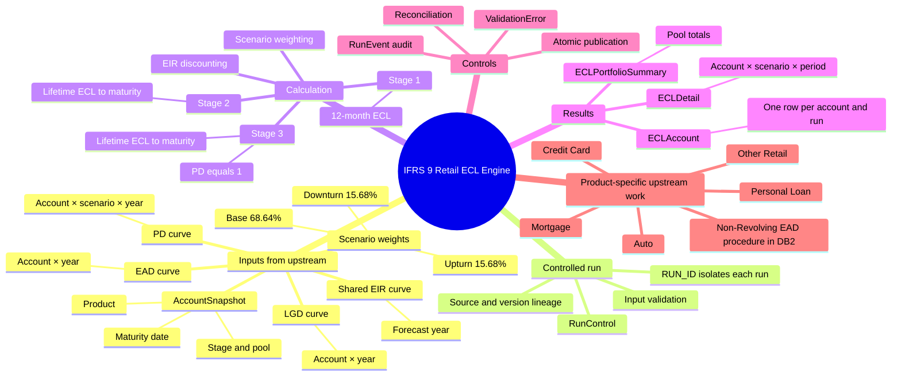
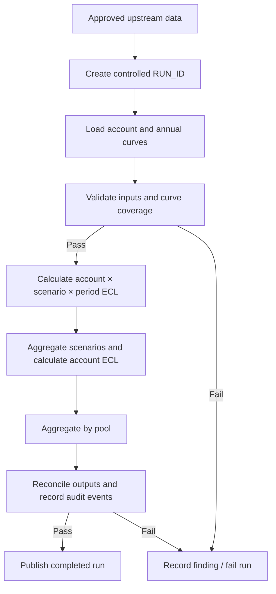

# IFRS 9 Retail ECL Engine

Production-oriented IFRS 9 expected credit loss (ECL) engine for retail lending, implemented in T-SQL. The current development and integration-test target is **SQL Server 2022**. Production deployment has not been verified by CI.

**Read in another language:** [Tiếng Việt — README.vi.md](README.vi.md)

> **Status:** ECL calculation and publication v1 are implemented in migrations 001–005; migration 006 adds shared EAD curve validation. SQL Server 2022 regression coverage includes synthetic formula, lifecycle, input-quality, reconciliation, and calculation rollback tests. A reproducible database deployment guide and clean-database end-to-end verification remain outstanding.

## 1. Understand the system in one minute

The engine is the calculation and governance layer between approved upstream risk data and published IFRS 9 ECL. It does **not** build PD, LGD, EAD, pool assignment, or Stage/SICR models. Upstream processes supply those results using the input contract.

The calculation at a high level is:

`ECL = PD × LGD × EAD × Discount Factor`

The engine calculates scenario-specific ECL, applies the versioned Downturn/Base/Upturn weights, aggregates outputs, validates and reconciles them, and publishes only a successful run.

## 2. System mindmap

## 3. End-to-end processing flow

A rerun must use a **new `RUN_ID`**. Do not overwrite the inputs or results of an earlier run. A run is not considered published merely because calculation rows exist.

## 4. Schema map: what each database schema is for

| Schema | Role | Main tables / objects | Questions it answers |
|---|---|---|---|
| `ecl_cfg` | Governed configuration | `PoolName`, `Scenario`, `ScenarioWeightVersion`, `ScenarioWeight` | Which pools/scenarios/weights are allowed for this run? |
| `ecl_stg` | Canonical input contract for a run | `AccountSnapshot`, `PDCurve`, `LGDCurve`, `EADCurve`, `EIRCurve` | Which account and annual curve rows were supplied to this run? |
| `ecl_core` | Run control and processing logic | `RunControl`, `usp_CalculateECL`, `usp_PublishECL`, `usp_LoadEADCurve` | Is the run valid, what state is it in, and which controlled operation runs next? |
| `ecl_result` | Calculation output | `ECLDetail`, `ECLAccount`, `ECLPortfolioSummary` | What was calculated at detail, account, pool, and portfolio level? |
| `ecl_audit` | Traceability and exceptions | `RunEvent`, `ValidationError` | What happened, when, how many rows were processed, and why did a check fail? |

### Grain (the most important design concept)

| Object | One row represents | Expected key / grain |
|---|---|---|
| `AccountSnapshot` | One account in a run | `RUN_ID + ACCOUNT_ID` |
| `PDCurve` | One account, scenario, and forecast period | `RUN_ID + ACCOUNT_ID + SCENARIO_CODE + FORECAST_PERIOD` |
| `LGDCurve` | One account and forecast period | `RUN_ID + ACCOUNT_ID + FORECAST_PERIOD` |
| `EADCurve` | One account and forecast period | `RUN_ID + ACCOUNT_ID + FORECAST_PERIOD` |
| `EIRCurve` | One forecast period shared across accounts | `RUN_ID + FORECAST_PERIOD` |
| `ECLDetail` | One account, scenario, and period contribution | `RUN_ID + ACCOUNT_ID + SCENARIO_CODE + FORECAST_PERIOD` |
| `ECLAccount` | One account result for a run | `RUN_ID + ACCOUNT_ID` |
| `ECLPortfolioSummary` | One pool name, Stage, aggregation level, and pool key for a run | `RUN_ID + POOL_NAME + STAGE + AGGREGATION_LEVEL + POOL_ID` |

`RUN_ID` isolates each run; `PROCESS_DATE` identifies the reporting/as-of date; `VERSION_ID` tracks the selected input/configuration version; `IS_ACTIVE` supports controlled row selection but does not replace run isolation.

## 5. Procedure map: which procedure does what?

| Procedure | Responsibility | When to read/call it |
|---|---|---|
| `ecl_core.usp_LoadAccountStagePoolSource` | Expands customer-level Stage to contract-level Stage/Pool staging, joining by PROCESS_DATE + CUSTOMER_ID + SEGMENT_ODR_LV1. | After upstream Stage data is ready. |
| `ecl_core.usp_LoadAccountSnapshot` | Loads canonical account rows from Stage/Pool staging, reads contract `expiry_date` as MATURITY_DATE, and validates `POOL_NAME` against `ecl_cfg.PoolName`. | After Stage/Pool staging. |
| `ecl_core.usp_LoadEADCurve` | Validates EAD rows already loaded into canonical `ecl_stg.EADCurve`: run/date alignment, VND, non-negative values, account matching, and annual coverage through maturity; records an audit event. It does **not** calculate product-specific EAD or copy from a second staging table. | After product-specific ETL loads EAD, before calculation. |
| `ecl_core.usp_CalculateECL` | Checks run state and required curves, calculates scenario × account × period contributions, writes detail/account/summary results, and records lifecycle/audit milestones in a transaction. | Main calculation step after input validation and loading. |
| `ecl_core.usp_PublishECL` | Allows only a successful run to be published, checks that outputs exist, rounds account/summary amounts to whole VND at the publication boundary, and transitions the run to `PUBLISHED`. | After calculation and reconciliation succeed. |
| Run-control / validation procedures | Create and transition runs, validate canonical inputs, persist validation findings and milestones. See migration headers and procedure definitions for exact names and contracts. | Before and around calculation/publication. |

For upstream DB2 Non-Revolving EAD, inspect `database/db2/README.md`, then `database/db2/001_create_nonrevolving_ead_schedule.sql`, `002_sp_calc_nonrevolving_ead.sql`, and `003_rename_auto_ead_objects.sql`. Product-specific ETL calculates annual EAD and lands it directly in the shared SQL Server contract `ecl_stg.EADCurve`; the shared loader validates the contract rather than reimplementing amortization rules.

## 6. Upstream Stage and pool configuration

Stage assignment from source buckets and segment-to-pool mapping are upstream responsibilities. See [Stage, segment and pool mapping](docs/stage-segment-pool-mapping.md) for bucket → Stage 1/2/3 rules, retail/corporate pool IDs, and the contract-level join from CUSTOMER_ODR_LRA_IRB to ODR_CONTRACT_LEVEL_IRB using PROCESS_DATE + CUSTOMER_ID + SEGMENT_ODR_LV1. CONTRACT_ID becomes ACCOUNT_ID; source segment normalization and duplicate-expansion checks are documented. The upstream loaders are `database/upstream/001_load_account_stage_pool_source.sql` (`ecl_core.usp_LoadAccountStagePoolSource`) and `database/upstream/002_load_account_snapshot.sql` (`ecl_core.usp_LoadAccountSnapshot`). The first prepares Stage/Pool separately. The second reads `expiry_date` as `MATURITY_DATE` and loads canonical AccountSnapshot and validates it against the seeded `ecl_cfg.PoolName` list.

## 7. Core IFRS 9 calculation conventions

- **Products:** Mortgage, Auto, Credit Card, Personal Loan, and Other Retail.
- **PD:** annual unconditional marginal PD on the original cohort, supplied upstream per scenario. Do not prorate PD for a partial final forecast year.
- **LGD:** supplied upstream; flat across scenarios in v1.
- **EAD:** supplied upstream as annual EAD at expected default, under a year-end convention. Do not prorate EAD for a partial final forecast year.
- **Horizon:** Stage 1 uses 12-month ECL; Stage 2 and Stage 3 run to contractual maturity.
- **Stage 3:** PD is set to 1; annual EAD/LGD/EIR curve conventions follow Stage 2.
- **Discounting:** `DF(t) = 1 / (1 + EIR(t))^t`. For a partial final year, the remaining-month fraction changes only discounting time/exponent.
- **Scenario weights:** Downturn 15.68%, Base 68.64%, Upturn 15.68%, selected from an immutable/versioned configuration set. Official external provenance remains a follow-up.
- **Currency:** VND; retain detail precision and round published account/summary ECL to whole VND.
- **POCI:** excluded from v1. Validation must not silently treat POCI as a regular loan.

Scenario-weighted ECL is the sum of each scenario's ECL contribution multiplied by its approved weight. The detail output retains inputs used in the calculation, including PD, LGD, EAD, EIR, discount factor, and scenario weight, for traceability.

## 8. Read the repository in this order

1. **This README** — system purpose, boundary, schema map, and end-to-end flow.
2. [Architecture](docs/architecture.md) — logical components and processing sequence.
3. [Canonical input contract](docs/canonical-input-contract.md) and [input/output contract](docs/input-output-contract.md) — required columns, row grains, and interface expectations.
4. [Database schema proposal](docs/database-schema-v1.0.md) — table-level keys, constraints, and relationships.
5. `database/001_create_logical_schema.sql` — physical DDL: schemas, tables, constraints, indexes.
6. `database/002_run_control.sql` — run lifecycle, transitions, validation, and audit.
7. `database/003_input_validation.sql` and `database/004_input_reconciliation.sql` — input quality and reconciliation checks.
8. `database/005_ecl_calculation.sql` — trace the core calculation and result writes.
9. `database/006_ead_curve_loader.sql` — shared EAD contract validation.
10. [SQL Server deployment guide](docs/sql-server-deployment-guide.md) and [tests](tests/sql/) — deployment steps and examples of expected behavior.

**How to read a procedure:** start with its header/comments, parameters, run-state checks, validation queries, transaction boundary, main INSERT/UPDATE, audit writes, and error handling. Then follow the referenced table names back to the schema map above.

## 9. Repository map

| Path | Purpose |
|---|---|
| `README.md` / `README.vi.md` | English overview / Vietnamese overview |
| `database/001–006*.sql` | Ordered SQL Server schema and procedure migrations |
| `database/db2/` | DB2 upstream Non-Revolving EAD table/procedure scripts |
| `database/upstream/` | SQL Server upstream loaders for Stage/Pool staging and canonical AccountSnapshot loading |
| `docs/architecture.md` | Logical architecture |
| `docs/canonical-input-contract.md` | Standardized input contract |
| `docs/database-schema-v1.0.md` | Logical tables, grains, keys, and constraints |
| `docs/methodology-specification-v1.0.md` | Calculation methodology |
| `docs/sql-server-deployment-guide.md` | Deployment guidance and operational safeguards |
| `docs/upstream-source-mapping.md` | Source-to-contract mapping notes |
| `docs/stage-segment-pool-mapping.md` | Upstream bucket-to-Stage and segment-to-pool mapping |
| `tests/sql/` | Synthetic SQL integration/regression tests |
| `TODO.md` and `docs/implementation-log/` | Roadmap and implementation decisions |

## 10. Testing and deployment status

- Synthetic SQL Server 2022 integration tests run in an ephemeral GitHub Actions SQL Server container.
- CI success demonstrates that the checked-in migrations/tests ran in that CI environment. It does **not** prove production readiness, successful deployment to another SQL Server, or SQL Server 2016 compatibility.
- A reproducible database deployment guide and clean-database end-to-end verification remain outstanding. Treat deployment as development/test only until these gaps and environment-specific approvals are complete.
- Never commit customer-identifiable data, credentials, or environment-specific secrets.
- Use synthetic, privacy-safe fixtures only; reruns must use a new `RUN_ID`.
- Deployment guide roadmap: [Issue #40](https://github.com/nguyenngocbinh/ifrs9-retail-ecl-engine/issues/40).

## 11. Further references

- [Project roadmap](TODO.md)
- [PR #39 — ECL calculation v1](docs/implementation-log/PR-039.md)
- [PR #41 — Calculation rollback fault-injection regression](docs/implementation-log/PR-041.md)
- [PR #44 — Shared EAD contract](docs/implementation-log/PR-044.md)
- [PR #45 — DB2 Non-Revolving EAD](docs/implementation-log/PR-045.md)
- [PR #46 — Rename shared EAD objects](docs/implementation-log/PR-046.md)
- [PR #47 — Upstream Stage and pool mapping](docs/implementation-log/PR-047.md)
- [PR #49 — Contract-level Stage and pool join keys](docs/implementation-log/PR-049.md)
- [PR #50 — Canonical POOL_NAME input and AccountSnapshot loader](docs/implementation-log/PR-050.md)

## Safety

Use synthetic, privacy-safe fixtures only. Do not run deployment scripts against a production database without environment approval, an approved backup/restore plan, and a reviewed deployment procedure.