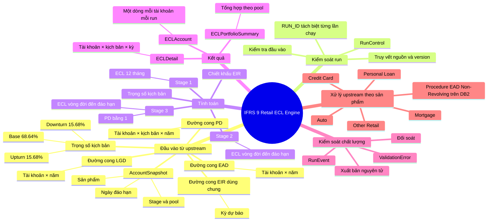
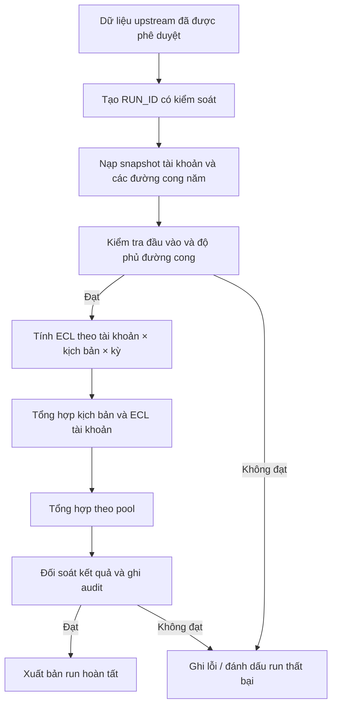

# IFRS 9 Retail ECL Engine — Tài liệu tiếng Việt

Engine tính **tổn thất tín dụng dự kiến (Expected Credit Loss — ECL)** theo IFRS 9 cho danh mục cho vay bán lẻ, được triển khai bằng T-SQL. Môi trường phát triển và kiểm thử tích hợp hiện tại là **SQL Server 2022**. CI chưa xác nhận khả năng triển khai production.

**English:** [README.md](README.md)

> **Trạng thái hiện tại:** Phần tính toán và xuất bản ECL v1 nằm trong migration 001–005; migration 006 bổ sung kiểm tra đường cong EAD dùng chung. CI có kiểm thử SQL Server 2022 bằng dữ liệu giả lập về công thức, vòng đời run, chất lượng đầu vào, đối soát và rollback khi lỗi tính toán. Hướng dẫn triển khai có thể lặp lại và kiểm chứng end-to-end trên database sạch vẫn là các việc cần hoàn thiện.

## 1. Hiểu hệ thống trong một phút

Engine này là lớp **điều phối, kiểm soát, tính ECL và xuất bản kết quả**. Engine không tự xây dựng mô hình PD, LGD, EAD, gán pool hoặc đánh giá Stage/SICR. Các hệ thống upstream phải cung cấp dữ liệu đã được phê duyệt theo hợp đồng đầu vào.

Công thức ở mức khái quát:

`ECL = PD × LGD × EAD × Hệ số chiết khấu`

Engine tính ECL theo từng kịch bản, áp dụng trọng số Downturn/Base/Upturn đã version hóa, tổng hợp kết quả, kiểm tra đối soát và chỉ xuất bản run thành công.

## 2. Mindmap tổng thể

## 3. Luồng xử lý từ đầu đến cuối

Mỗi lần chạy lại phải sử dụng **`RUN_ID` mới**. Không ghi đè dữ liệu đầu vào hoặc kết quả của run cũ. Việc đã có dòng kết quả tính toán không đồng nghĩa run đã được xuất bản.

## 4. Bản đồ schema: từng schema có vai trò gì?

| Schema | Vai trò | Bảng/đối tượng chính | Câu hỏi được trả lời |
|---|---|---|---|
| `ecl_cfg` | Cấu hình có kiểm soát | `PoolName`, `Scenario`, `ScenarioWeightVersion`, `ScenarioWeight` | Pool, kịch bản và bộ trọng số nào được phép dùng cho run? |
| `ecl_stg` | Hợp đồng dữ liệu đầu vào chuẩn hóa theo run | `AccountSnapshot`, `PDCurve`, `LGDCurve`, `EADCurve`, `EIRCurve` | Run đang sử dụng những tài khoản và đường cong năm nào? |
| `ecl_core` | Quản lý vòng đời run và logic xử lý | `RunControl`, `usp_CalculateECL`, `usp_PublishECL`, `usp_LoadEADCurve` | Run đang ở trạng thái nào và bước xử lý tiếp theo là gì? |
| `ecl_result` | Kết quả tính toán | `ECLDetail`, `ECLAccount`, `ECLPortfolioSummary` | Kết quả chi tiết, theo tài khoản, pool và toàn danh mục là bao nhiêu? |
| `ecl_audit` | Truy vết và lưu ngoại lệ | `RunEvent`, `ValidationError` | Đã xảy ra việc gì, khi nào, xử lý bao nhiêu dòng và vì sao kiểm tra thất bại? |

### Grain — khái niệm quan trọng nhất khi thiết kế bảng

| Đối tượng | Một dòng đại diện cho | Grain/khóa kỳ vọng |
|---|---|---|
| `AccountSnapshot` | Một tài khoản trong một run | `RUN_ID + ACCOUNT_ID` |
| `PDCurve` | Một tài khoản, một kịch bản, một kỳ dự báo | `RUN_ID + ACCOUNT_ID + SCENARIO_CODE + FORECAST_PERIOD` |
| `LGDCurve` | Một tài khoản, một kỳ dự báo | `RUN_ID + ACCOUNT_ID + FORECAST_PERIOD` |
| `EADCurve` | Một tài khoản, một kỳ dự báo | `RUN_ID + ACCOUNT_ID + FORECAST_PERIOD` |
| `EIRCurve` | Một kỳ dự báo dùng chung cho các tài khoản | `RUN_ID + FORECAST_PERIOD` |
| `ECLDetail` | Đóng góp ECL của một tài khoản, kịch bản, kỳ | `RUN_ID + ACCOUNT_ID + SCENARIO_CODE + FORECAST_PERIOD` |
| `ECLAccount` | Kết quả một tài khoản trong một run | `RUN_ID + ACCOUNT_ID` |
| `ECLPortfolioSummary` | Một pool name, Stage, cấp tổng hợp và khóa pool trong một run | `RUN_ID + POOL_NAME + STAGE + AGGREGATION_LEVEL + POOL_ID` |

Các trường điều khiển cần nhớ:

- `RUN_ID`: cô lập từng lần chạy, ngăn kết quả các lần chạy ghi đè nhau.
- `PROCESS_DATE`: ngày báo cáo/ngày chốt dữ liệu.
- `VERSION_ID`: truy vết version dữ liệu đầu vào hoặc cấu hình được chọn.
- `IS_ACTIVE`: hỗ trợ chọn các dòng/version đang hoạt động; **không thay thế** việc phân tách dữ liệu bằng `RUN_ID`.

## 5. Bản đồ procedure: procedure nào làm gì?

| Procedure | Trách nhiệm | Thời điểm đọc/chạy |
|---|---|---|
| `ecl_core.usp_LoadAccountStagePoolSource` | Mở rộng Stage từ cấp khách hàng xuống hợp đồng và nạp Stage/Pool staging theo khóa PROCESS_DATE + CUSTOMER_ID + SEGMENT_ODR_LV1. | Sau khi dữ liệu Stage nguồn sẵn sàng. |
| `ecl_core.usp_LoadAccountSnapshot` | Nạp snapshot chuẩn từ bảng Stage/Pool, lấy `expiry_date` làm `MATURITY_DATE`, kiểm tra `POOL_NAME` với danh mục `ecl_cfg.PoolName`. | Sau khi nạp Stage/Pool. |
| `ecl_core.usp_LoadEADCurve` | Kiểm tra EAD đã được nạp trực tiếp vào `ecl_stg.EADCurve`: ngày xử lý, đơn vị VND, EAD không âm, tài khoản khớp snapshot và đủ các kỳ năm đến đáo hạn; ghi audit. Procedure **không** tự tính EAD theo sản phẩm và không sao chép từ một bảng staging trung gian khác. | Sau ETL EAD theo sản phẩm, trước bước tính ECL. |
| `ecl_core.usp_CalculateECL` | Kiểm tra trạng thái run và độ đầy đủ đường cong; tính đóng góp ECL theo kịch bản × tài khoản × kỳ; ghi kết quả detail/account/summary và audit trong transaction. | Bước tính toán chính sau khi nạp và kiểm tra đầu vào. |
| `ecl_core.usp_PublishECL` | Chỉ cho phép xuất bản run thành công, kiểm tra kết quả tồn tại, làm tròn số tiền kết quả tài khoản/tổng hợp về VND nguyên tại ranh giới xuất bản và chuyển trạng thái sang `PUBLISHED`. | Sau khi tính toán và đối soát đạt. |
| Các procedure quản lý run/validation | Tạo run, quản lý chuyển trạng thái, kiểm tra đầu vào chuẩn hóa, lưu lỗi kiểm tra và các mốc xử lý. Xem migration và định nghĩa procedure để biết chính xác tên/tham số. | Trước và trong quá trình tính toán/xuất bản. |

Với EAD Non-Revolving xử lý upstream trên DB2, đọc theo thứ tự: `database/db2/README.md`, `database/db2/001_create_nonrevolving_ead_schedule.sql`, `002_sp_calc_nonrevolving_ead.sql`, rồi `003_rename_auto_ead_objects.sql`. ETL theo sản phẩm tính EAD năm và nạp trực tiếp vào hợp đồng chuẩn dùng chung `ecl_stg.EADCurve`; procedure loader chỉ kiểm tra hợp đồng dữ liệu, không viết lại quy tắc khấu hao/trả nợ của từng sản phẩm.

## 6. Cấu hình Stage và mapping pool upstream

Quy tắc gán Stage từ bucket nguồn và mapping segment sang pool thuộc trách nhiệm upstream. Xem [Stage, segment và pool mapping](docs/stage-segment-pool-mapping.md) để biết mapping bucket → Stage 1/2/3 và cách mở rộng Stage xuống cấp hợp đồng bằng JOIN theo PROCESS_DATE + CUSTOMER_ID + SEGMENT_ODR_LV1 giữa CUSTOMER_ODR_LRA_IRB và ODR_CONTRACT_LEVEL_IRB. CONTRACT_ID được dùng làm ACCOUNT_ID; tài liệu cũng mô tả chuẩn hóa segment và kiểm tra tránh nhân bản hợp đồng. Hai script upstream là `database/upstream/001_load_account_stage_pool_source.sql` (`ecl_core.usp_LoadAccountStagePoolSource`) và `database/upstream/002_load_account_snapshot.sql` (`ecl_core.usp_LoadAccountSnapshot`). Procedure đầu nạp Stage/Pool vào bảng staging riêng. Procedure thứ hai lấy `expiry_date` của hợp đồng làm `MATURITY_DATE` và nạp `AccountSnapshot`, kiểm tra `POOL_NAME` có trong danh mục `ecl_cfg.PoolName` và đang hoạt động.

## 7. Các quy ước tính toán IFRS 9 chính

- **Sản phẩm:** Mortgage, Auto, Credit Card, Personal Loan và Other Retail.
- **PD:** PD biên vô điều kiện theo năm trên original cohort, được upstream cung cấp riêng theo kịch bản. Không phân bổ lại PD cho năm dự báo cuối bị lẻ.
- **LGD:** upstream cung cấp; v1 giả định LGD không đổi giữa các kịch bản.
- **EAD:** upstream cung cấp theo năm tại thời điểm vỡ nợ kỳ vọng, theo quy ước cuối năm. Không phân bổ lại EAD cho năm cuối bị lẻ.
- **Horizon:** Stage 1 dùng ECL 12 tháng; Stage 2 và Stage 3 chạy đến ngày đáo hạn hợp đồng.
- **Stage 3:** PD được đặt bằng 1; quy ước đường cong EAD/LGD/EIR theo năm giống Stage 2.
- **Chiết khấu:** `DF(t) = 1 / (1 + EIR(t))^t`. Với năm cuối không đủ 12 tháng, phần tháng còn lại chỉ điều chỉnh thời gian/số mũ chiết khấu.
- **Trọng số kịch bản:** Downturn 15,68%, Base 68,64%, Upturn 15,68%, lấy từ bộ cấu hình bất biến có quản lý version. Nguồn dẫn chính thức của trọng số vẫn là hạng mục cần bổ sung.
- **Tiền tệ:** VND; giữ độ chính xác khi tính toán và làm tròn kết quả tài khoản/tổng hợp về VND nguyên khi xuất bản.
- **POCI:** chưa nằm trong phạm vi v1. Kiểm tra đầu vào không được âm thầm xử lý POCI như khoản vay thông thường.

ECL tổng hợp theo kịch bản bằng cách nhân ECL từng kịch bản với trọng số được duyệt rồi cộng lại. Bảng detail lưu dấu vết PD, LGD, EAD, EIR, hệ số chiết khấu và trọng số đã sử dụng.

## 8. Thứ tự đọc repository để hiểu nhanh

1. **README này** — mục tiêu, ranh giới trách nhiệm, schema và luồng tổng thể.
2. [Architecture](docs/architecture.md) — các thành phần logic và thứ tự xử lý.
3. [Canonical input contract](docs/canonical-input-contract.md) và [input/output contract](docs/input-output-contract.md) — cột bắt buộc, grain từng dòng và giao diện dữ liệu.
4. [Database schema proposal](docs/database-schema-v1.0.md) — khóa, ràng buộc và quan hệ giữa các bảng.
5. `database/001_create_logical_schema.sql` — DDL vật lý: schema, bảng, constraint, index.
6. `database/002_run_control.sql` — vòng đời run, chuyển trạng thái, validation và audit.
7. `database/003_input_validation.sql` và `database/004_input_reconciliation.sql` — kiểm tra chất lượng và đối soát đầu vào.
8. `database/005_ecl_calculation.sql` — theo dõi công thức tính và nơi ghi kết quả.
9. `database/006_ead_curve_loader.sql` — kiểm tra hợp đồng EAD dùng chung.
10. [SQL Server deployment guide](docs/sql-server-deployment-guide.md) và [tests](tests/sql/) — quy trình triển khai, tình huống kiểm thử và kết quả mong đợi.

**Cách đọc một procedure:** bắt đầu từ comment/header, tham số, điều kiện trạng thái run, các câu truy vấn validation, ranh giới transaction, câu INSERT/UPDATE chính, audit và xử lý lỗi. Khi gặp tên bảng, đối chiếu ngược với bản đồ schema ở mục 4.

## 9. Bản đồ thư mục

| Đường dẫn | Nội dung |
|---|---|
| `README.md` / `README.vi.md` | Tổng quan tiếng Anh / tiếng Việt |
| `database/001–006*.sql` | Các migration SQL Server theo thứ tự |
| `database/db2/` | Script bảng và procedure EAD Non-Revolving upstream trên DB2 |
| `database/upstream/` | SQL loader upstream trên SQL Server cho Stage/Pool staging và nạp AccountSnapshot chuẩn |
| `docs/architecture.md` | Kiến trúc logic |
| `docs/canonical-input-contract.md` | Hợp đồng đầu vào chuẩn hóa |
| `docs/database-schema-v1.0.md` | Bảng, grain, khóa và constraint |
| `docs/methodology-specification-v1.0.md` | Đặc tả phương pháp tính |
| `docs/sql-server-deployment-guide.md` | Hướng dẫn triển khai và lưu ý vận hành |
| `docs/upstream-source-mapping.md` | Ghi chú mapping nguồn upstream |
| `docs/stage-segment-pool-mapping.md` | Mapping bucket sang Stage và segment sang pool upstream |
| `tests/sql/` | Kiểm thử tích hợp/hồi quy bằng dữ liệu giả lập |
| `TODO.md` và `docs/implementation-log/` | Lộ trình và quyết định theo từng lần triển khai |

## 10. Trạng thái kiểm thử và triển khai

- Kiểm thử tích hợp SQL Server 2022 dùng dữ liệu giả lập chạy trong container SQL Server tạm thời của GitHub Actions.
- CI thành công chỉ chứng minh các migration/test được commit đã chạy trong môi trường CI đó. **Không** chứng minh hệ thống sẵn sàng production, triển khai thành công trên SQL Server khác hoặc tương thích SQL Server 2016.
- Hướng dẫn triển khai có thể lặp lại và kiểm chứng end-to-end trên database sạch vẫn cần hoàn thiện. Chỉ triển khai vào môi trường dev/test cho đến khi các điểm thiếu và phê duyệt theo môi trường đã được xử lý.
- Không commit dữ liệu có thể nhận diện khách hàng, thông tin xác thực hoặc secret của môi trường.
- Chỉ dùng dữ liệu test tổng hợp, an toàn về quyền riêng tư; mỗi lần chạy lại phải có `RUN_ID` mới.
- Lộ trình hướng dẫn triển khai: [Issue #40](https://github.com/nguyenngocbinh/ifrs9-retail-ecl-engine/issues/40).

## 11. Tài liệu tham khảo thêm

- [Project roadmap](TODO.md)
- [PR #39 — ECL calculation v1](docs/implementation-log/PR-039.md)
- [PR #41 — Calculation rollback fault-injection regression](docs/implementation-log/PR-041.md)
- [PR #44 — Shared EAD contract](docs/implementation-log/PR-044.md)
- [PR #45 — DB2 Non-Revolving EAD](docs/implementation-log/PR-045.md)
- [PR #46 — Rename shared EAD objects](docs/implementation-log/PR-046.md)
- [PR #47 — Upstream Stage and pool mapping](docs/implementation-log/PR-047.md)
- [PR #49 — Contract-level Stage and pool join keys](docs/implementation-log/PR-049.md)
- [PR #50 — Canonical POOL_NAME input and AccountSnapshot loader](docs/implementation-log/PR-050.md)

## An toàn

Chỉ dùng dữ liệu giả lập không chứa thông tin khách hàng. Không chạy script triển khai vào production nếu chưa có phê duyệt môi trường, phương án backup/restore được duyệt và quy trình triển khai đã được review.