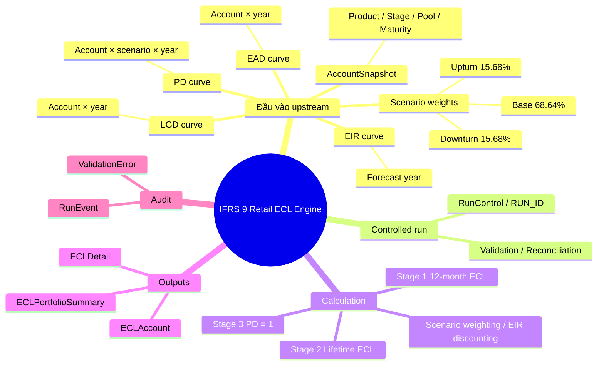
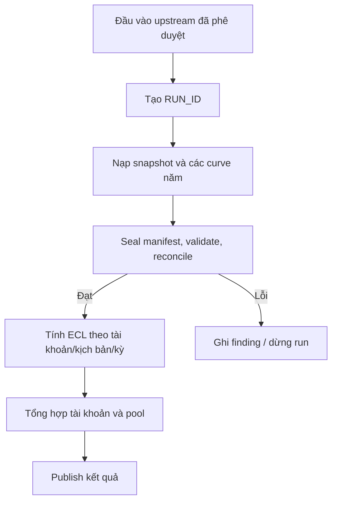

# IFRS 9 Retail ECL Engine — Tài liệu tiếng Việt

Engine tính **tổn thất tín dụng dự kiến (Expected Credit Loss — ECL)** theo IFRS 9 cho danh mục cho vay bán lẻ, triển khai bằng T-SQL. Môi trường phát triển/kiểm thử mục tiêu hiện tại là **SQL Server 2022**.

**Đọc nhanh:** bắt đầu với mục [Thứ tự triển khai](docs/implementation-runbook.vi.md). Tài liệu đó nêu thứ tự chạy script, các đầu vào bắt buộc, cách điều phối một RUN_ID và cách kiểm tra kết quả. Sau đó quay lại README này để hiểu kiến trúc và schema.

**English:** [README.md](README.md)

> **Trạng thái hiện tại:** các migration 001–008 định nghĩa schema, run control, validation/reconciliation, tính toán ECL và kiểm tra các curve dùng chung. CI có bộ test SQL Server 2022 bằng dữ liệu giả lập. Tài liệu triển khai không thay thế việc kiểm thử trên database DEV/UAT và phê duyệt nghiệp vụ/IT trước production.

## 1. Hiểu hệ thống trong một phút

Engine là lớp **điều phối, kiểm soát, tính ECL và xuất bản kết quả**. Nó không tự xây dựng mô hình PD, LGD, EAD, gán pool hoặc đánh giá Stage/SICR. Các quy trình upstream phải cung cấp dữ liệu đã được phê duyệt theo hợp đồng đầu vào.

Công thức khái quát: `ECL = PD × LGD × EAD × Hệ số chiết khấu`.

Engine tính theo từng kịch bản, áp dụng trọng số Downturn/Base/Upturn đã version hóa, tổng hợp, đối soát và chỉ xuất bản run hợp lệ. `ecl_cfg.PoolName` quản lý mapping `POOL_NAME` chuẩn với `SEGMENT` dùng trong đối chiếu nguồn PD.

## 2. Mindmap tổng thể

## 3. Luồng xử lý end-to-end

Mỗi lần chạy lại phải sử dụng **RUN_ID mới**; không ghi đè đầu vào/kết quả run cũ. Có dòng kết quả tính toán không đồng nghĩa run đã được publish.

## 4. Bản đồ schema

| Schema | Vai trò | Đối tượng chính |
|---|---|---|
| `ecl_cfg` | Cấu hình | `PoolName`, `Scenario`, `ScenarioWeightVersion`, `ScenarioWeight` |
| `ecl_stg` | Đầu vào chuẩn của từng run | `AccountSnapshot`, `PDCurve`, `LGDCurve`, `EADCurve`, `EIRCurve` |
| `ecl_core` | Vòng đời và logic xử lý | `RunControl`, các procedure load/validate/calculate/publish |
| `ecl_result` | Kết quả | `ECLDetail`, `ECLAccount`, `ECLPortfolioSummary` |
| `ecl_audit` | Audit và ngoại lệ | `RunEvent`, `ValidationError` |

### Grain cần nhớ

| Đối tượng | Một dòng đại diện cho |
|---|---|
| `AccountSnapshot` | Một tài khoản trong một run: `RUN_ID + ACCOUNT_ID` |
| `PDCurve` | Một tài khoản/kịch bản/kỳ: `RUN_ID + ACCOUNT_ID + SCENARIO_CODE + FORECAST_PERIOD` |
| `LGDCurve`, `EADCurve` | Một tài khoản/kỳ năm: `RUN_ID + ACCOUNT_ID + FORECAST_PERIOD` |
| `EIRCurve` | Một kỳ năm dùng chung: `RUN_ID + FORECAST_PERIOD` |
| `ECLDetail` | Một tài khoản/kịch bản/kỳ tính ECL |
| `ECLAccount` | Một kết quả tài khoản trong run |
| `ECLPortfolioSummary` | Tổng hợp theo pool/Stage hoặc toàn danh mục trong run |

`RUN_ID` cô lập lần chạy; `PROCESS_DATE` là ngày báo cáo; `VERSION_ID` giúp truy vết phiên bản nguồn; `IS_ACTIVE` không thay thế `RUN_ID`.

## 5. Procedure map

| Procedure | Trách nhiệm |
|---|---|
| `ecl_core.usp_LoadAccountStagePoolSource` | Mở rộng Stage/Pool từ khách hàng xuống hợp đồng theo khóa nguồn đã thiết kế. |
| `ecl_core.usp_LoadAccountSnapshot` | Nạp AccountSnapshot chuẩn, xác nhận `POOL_NAME`, lấy maturity date từ hợp đồng. |
| `ecl_core.usp_LoadPDCurve` | Kiểm tra PD curve năm đã nạp đủ theo scenario và maturity. |
| `ecl_core.usp_LoadLGDCurve` | Kiểm tra LGD curve năm đã nạp đủ theo maturity. |
| `ecl_core.usp_LoadEADCurve` | Kiểm tra EAD curve năm đã nạp đủ, đúng VND và khớp tài khoản. |
| `ecl_core.usp_ValidateRunInputs` / `usp_ReconcileInputSnapshots` | Kiểm tra chất lượng và đối soát manifest với dữ liệu thực tế. |
| `ecl_core.usp_CalculateECL` | Tính ECL theo tài khoản/kịch bản/kỳ và ghi kết quả. |
| `ecl_core.usp_PublishECL` | Publish run thành công và làm tròn số tiền theo VND. |

**Lưu ý quan trọng:** các curve loader kiểm tra dữ liệu đã được ETL vào bảng chuẩn; chúng không tự tạo mô hình hay tự kéo dữ liệu từ DB2/MSSQL nguồn. PD, LGD, EAD và EIR vẫn cần quy trình ETL riêng. Xem [hướng dẫn triển khai](docs/implementation-runbook.vi.md).

## 6. Quy ước tính ECL v1

- PD: marginal, unconditional, theo năm và theo scenario; sử dụng original cohort.
- LGD: cung cấp từ upstream; phẳng theo scenario trong v1.
- EAD: cung cấp từ upstream theo quy ước cuối năm; đơn vị VND.
- Stage 1: ECL 12 tháng. Stage 2 và Stage 3: đến maturity.
- Stage 3: PD dùng trong công thức bằng 1; sử dụng curve EAD/LGD/EIR như quy ước v1.
- Chiết khấu: `DF(t) = 1 / (1 + EIR(t))^t`. Với kỳ cuối lẻ, chỉ điều chỉnh `t`, không prorate PD/EAD.
- Trọng số thiết kế: Downturn 15.68%, Base 68.64%, Upturn 15.68%; phải sử dụng version có hiệu lực tại `RunControl.PROCESS_DATE`, đủ ba kịch bản và tổng bằng 1. Bảng `ScenarioWeight` không lưu `PROCESS_DATE` vì trọng số gắn với phiên bản.
- Đơn vị báo cáo VND; POCI ngoài phạm vi v1 và không được âm thầm xử lý như khoản vay thông thường.

## 7. Đọc repo theo thứ tự

1. [Hướng dẫn triển khai tiếng Việt](docs/implementation-runbook.vi.md) — thứ tự thực hiện và chạy thử.
2. [SQL Server deployment guide](docs/sql-server-deployment-guide.md) — triển khai database sạch và chạy bộ test.
3. [Canonical input contract](docs/canonical-input-contract.md) và [input/output contract](docs/input-output-contract.md) — grain và cấu trúc dữ liệu.
4. [Stage/segment/pool mapping](docs/stage-segment-pool-mapping.md) — mapping Stage và pool upstream.
5. [Database schema](docs/database-schema-v1.0.md) và [methodology](docs/methodology-specification-v1.0.md) — chi tiết bảng và phương pháp.
6. `database/001–009*.sql` — DDL và procedure theo thứ tự migration.
7. `tests/sql/` — ví dụ kiểm thử/hành vi mong đợi bằng dữ liệu giả lập.

## 8. Cấu trúc repo

| Đường dẫn | Nội dung |
|---|---|
| `README.md` / `README.vi.md` | Tổng quan tiếng Anh / tiếng Việt |
| `docs/implementation-runbook.vi.md` | Hướng dẫn triển khai và chạy thử từng bước |
| `database/001–008*.sql` | Migration SQL Server |
| `database/upstream/` | Script Stage/Pool và AccountSnapshot — cần rà soát source mapping |
| `database/db2/` | Script EAD Non-Revolving upstream trên DB2 |
| `docs/` | Kiến trúc, hợp đồng dữ liệu, mapping và phương pháp |
| `tests/sql/` | Kiểm thử SQL bằng dữ liệu giả lập |

## 9. Trạng thái và giới hạn

CI SQL Server 2022 chỉ xác nhận code và test chạy trong môi trường CI. Nó không chứng minh production-ready, mapping nguồn đã đúng, quyền đã đầy đủ, hay hiệu năng/backup/monitoring đã được phê duyệt. Hãy chạy trước trên database DEV/UAT dùng riêng, chỉ dùng dữ liệu giả lập để test, rà soát source mapping, và chuẩn bị backup/restore + rollback trước mọi triển khai thật. Chưa có một ETL end-to-end dùng chung cho mọi nguồn PD/LGD/EAD/EIR và mọi sản phẩm.
